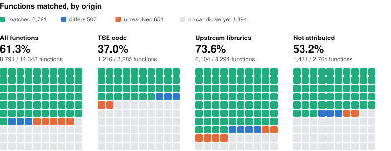
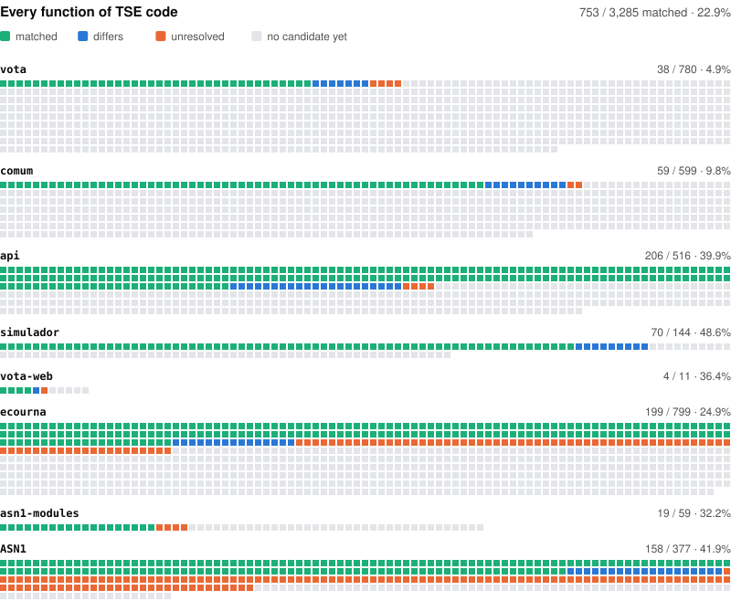
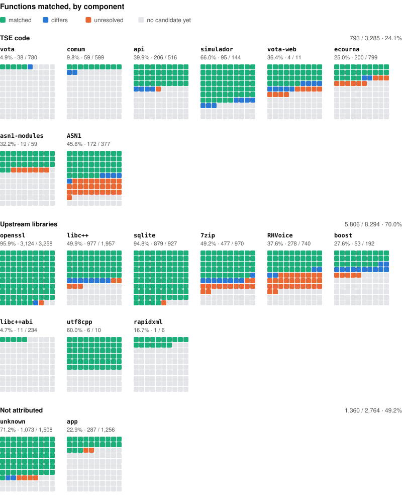

# UrnaDecomp 

🗳️ _Matching decompilation of the TSE voting simulator_

> ⚠️ **Notice:** This is an independent matching decompilation of the TSE's unmodified files.
>
> **Matching decompilation.** UrnaDecomp rebuilds C++ source that compiles back, byte for byte, to `vota_web_wasm.wasm`: VOTA, the voting application of the TSE's voting simulator. The target files belong to the TSE and are used and redistributed unmodified.
>
> **Independent.** The files are the ones the TSE publishes in its Voting Simulator. The project is not affiliated with or endorsed by the TSE or the Electoral Justice.
>
> **Why.** To document, openly and verifiably, how VOTA works as the TSE publishes it in the simulator: anyone can rebuild the matched code and check it against the module, byte for byte.
>
> **No evidence of fraud.** Nothing in this project is evidence of electoral fraud, and it cannot be: it studies the simulator's module, not the software sealed into the voting machines, and says nothing about the result of any election. Presenting this code as evidence of fraud misrepresents it; where the reconstruction and the module disagree, the reconstruction is wrong.
>
> **Takedown.** The TSE or another competent authority can ask for this project, or the TSE files in it, to be taken down by opening an [issue on GitHub](https://github.com/macabeus/UrnaDecomp/issues).
>
> In the news: [Estadão / TecMundo](https://www.estadao.com.br/tecmundo/ciberseguranca/simulador-de-votacao-exibe-codigo-do-app-da-urna-eletronica-tse-afirma-intencao/) (in Portuguese). The TSE told the outlet that reusing the voting machine's C++ code in the WebAssembly simulator was a deliberate choice, that code reconstructed from it reveals no secrets, and that it does not intend to ask for its removal.

Brazil's electoral court, the TSE (Tribunal Superior Eleitoral), publishes a voting simulator that runs the urna's
voter-facing software in a browser. Its core is one WebAssembly module, `target/vota_web_wasm.wasm`: 7.7 MB and
14,343 functions, compiled by Emscripten from TSE's C++ (the `uenux2` application and the `ecourna` library)
together with upstream libraries such as OpenSSL, SQLite, 7-Zip and RHVoice.

This project rewrites that C++ so that a pinned Emscripten toolchain rebuilds the module byte for byte. Progress is
measured by the **splat build**: the target is split into pieces, every function whose body our build provably
produces is replaced by our own bytes, and the result must still be the target's sha256
`8579ef8d1a93819152cecdbf52906d2e4dd0f57999cb2e1e8c0d1161cd1007e2`.

## Status

<!-- status:headline -->
**9,972 of 14,343 functions matched (69.53%), 2,673,084 of 5,883,903 code bytes (45.43%).**
<!-- /status:headline -->

<picture>
  <source media="(prefers-color-scheme: dark)" srcset="docs/img/progress-origins-dark.svg">
  
</picture>

<picture>
  <source media="(prefers-color-scheme: dark)" srcset="docs/img/progress-tse-dark.svg">
  
</picture>

<details>
<summary>Every component</summary>

<picture>
  <source media="(prefers-color-scheme: dark)" srcset="docs/img/progress-components-dark.svg">
  
</picture>

</details>

Each square is coloured by the function's verdict in the scan: matched, differs (our body exists and differs),
unresolved (our body names something the target lacks) or no candidate yet. [docs/status.md](docs/status.md) has the
numbers as tables, how a match is counted, what a component is, and what is left.

## Quick start

[docs/getting-started.md](docs/getting-started.md) takes a fresh clone to a verified splat build. Its last two steps:

```sh
TMPDIR=/tmp make -C src link     # our whole-program link, into build/out/wasm/vota_web/
TMPDIR=/tmp make -C src splat    # must print sha256 8579ef8d…1007e2 and the meter
```

`TMPDIR=/tmp` is needed on macOS: docker cannot mount the default `/var/folders` temp directory.

[docs/how-to-decompile.md](docs/how-to-decompile.md) then walks one function from the work list to a match. With
Claude Code, the [`/decompile-functions`](.claude/commands/decompile-functions.md) command runs a whole round: it picks
functions, matches each in its own worktree, has a second agent verify every match, and lands them on `main`.

## Repository

| path | what |
| --- | --- |
| `target/` | the TSE files being rebuilt, unchanged |
| `src/` | the reconstructed C++ and the build |
| `splat/` | the match list, the scan (the work list) and the target's symbols |
| `ledger/` | what the project knows about the target, as data |
| `tools/` | every script |
| `asmlift-wasm/` | the decompilation toolkit |
| `build/` | the toolchain pin |
| `third_party/` | the upstream libraries' pinned versions (sources are fetched, not tracked) |
| `docs/` | the how-tos, the glossary and the reference pages |

[docs/README.md](docs/README.md) is the index of every document, the READMEs beside the code included.

## The toolkit

`asmlift-wasm/` adds WebAssembly to [asmlift](https://www.npmjs.com/package/@asmlift/core), the matching decompiler:
a readout of any function, a lift to compilable C++, the census and the splat build. It is a fork of asmlift 0.9.0,
vendored so that a fix to the tool lands with the C++ it helped write.

```sh
cd asmlift-wasm
pnpm install
pnpm wasm fn ../target/vota_web_wasm.wasm 1931     # readout of target function 1931
pnpm test && pnpm typecheck
```
